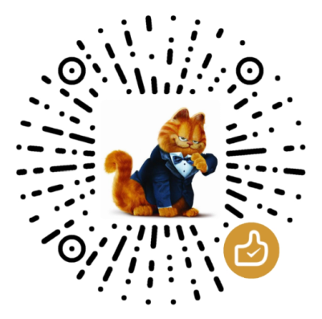

# ご支援・スポンサーシップ

> 夜遅くまでコードを書き、`Becky!` のあらゆる UI 要素をキャプチャ・解析・翻訳・テストする日々の中で、数え切れないほどの脳細胞と膨大な量の AI トークンを消費してきました😊
>
> 開発を続けていくためのエネルギーとして、数時間分の AI トークンをご支援いただけると嬉しいです🙏

## ご支援の方法

<table width="100%">
  <tr style="height: 200px;">
    <td width="50%" align="center" valign="top">
      <h3>I. GitHub</h3>
      
GitHub 経由での継続支援または 1 回限りのスポンサーシップ。

      

        
      

      

      

    </td>
    <td width="50%" align="center" valign="top">
      <h3>II. PayPal</h3>
      
PayPal.Me 経由での直接送金によるご支援。

      

        
      

    </td>
  </tr>
  <tr>
    <td width="50%" align="center" valign="top">
      <h3>III. WeChat</h3>
      
WeChat アプリで QR コードをスキャンしてご支援いただけます。

      

        
      

    </td>
    <td width="50%" align="center" valign="top">
      <h3>IV. Alipay（アリペイ）</h3>
      
Alipay アプリで QR コードをスキャンしてご支援いただけます。

      

        
      

    </td>
  </tr>
</table>