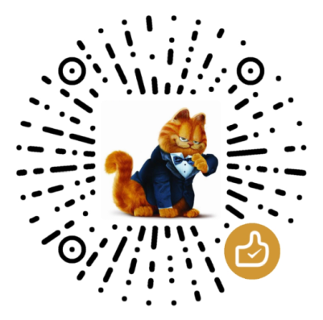

# Patronage & Sponsorship

> Late nights of coding—capturing, analyzing, translating, and testing every single UI element in Becky!—have burned through countless brain cells and a massive pile of AI tokens.
>
> Consider sponsoring a few hours' worth of AI tokens to keep me going! 😊

## Sponsorship Channels

<table width="100%">
  <tr style="height: 200px;">
    <td width="50%" align="center" valign="top">
      <h3>I. GitHub Sponsors</h3>
      
Recurring or one-time sponsorship via GitHub.

      

        
      

      

      

    </td>
    <td width="50%" align="center" valign="top">
      <h3>II. PayPal</h3>
      
Direct international transfer via PayPal.Me.

      

        
      

    </td>
  </tr>
  <tr>
    <td width="50%" align="center" valign="top">
      <h3>III. WeChat Pay</h3>
      
Scan with WeChat to send appreciation.

      

        
      

    </td>
    <td width="50%" align="center" valign="top">
      <h3>IV. Alipay</h3>
      
Scan with Alipay to send support.

      

        
      

    </td>
  </tr>
</table>

