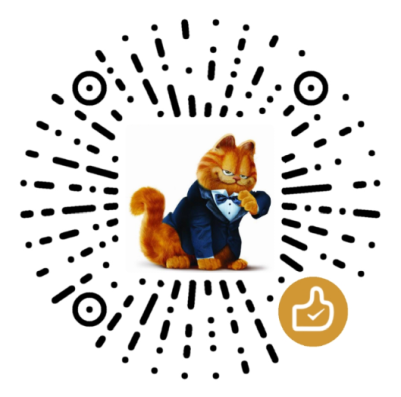

# 赞赏与支持

> 熬夜，编程，抓取、分析、翻译并测试 `Becky!` 的每一个界面元素，消耗了大量脑细胞和 AI Tokens😊
>
> 不妨赞助几小时的 AI Tokens 吧🙏

## 赞助与支持方式

<table width="100%">
  <tr style="height: 200px;">
    <td width="50%" align="center" valign="top">
      <h3>I. GitHub</h3>
      
通过 GitHub 按月赞助或单次支持

      

        
      

      

      

    </td>
    <td width="50%" align="center" valign="top">
      <h3>II. PayPal</h3>
      
通过 PayPal.Me 进行国际转账支持

      

        
      

    </td>
  </tr>
  <tr>
    <td width="50%" align="center" valign="top">
      <h3>III. 微信</h3>
      
使用微信扫描二维码赞赏支持

      

        
      

    </td>
    <td width="50%" align="center" valign="top">
      <h3>IV. 支付宝</h3>
      
使用支付宝扫描二维码赞助支持

      

        
      

    </td>
  </tr>
</table>